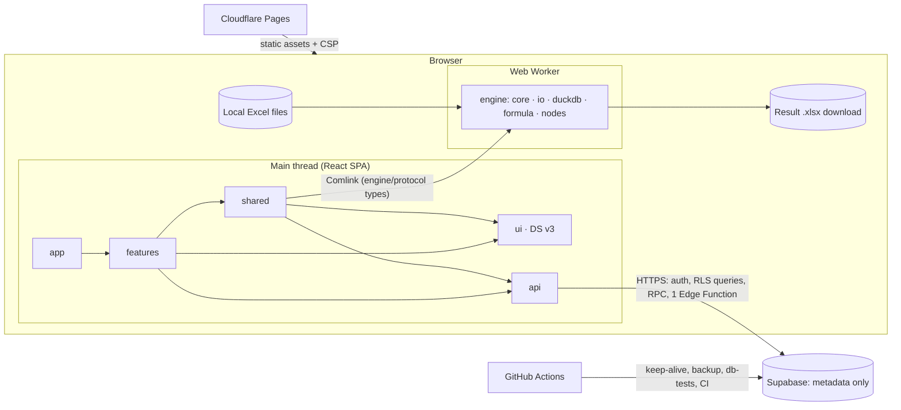
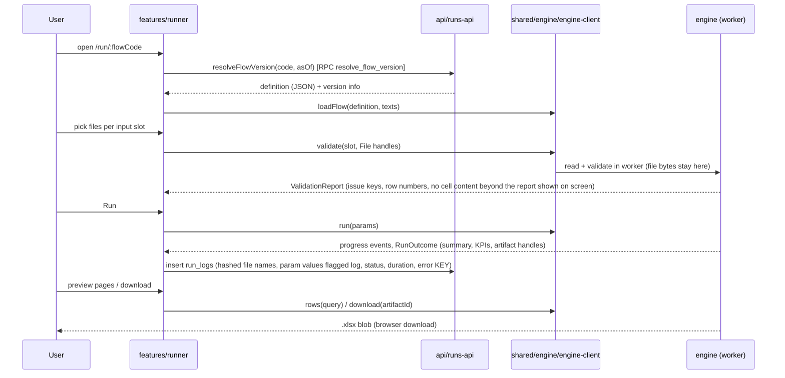
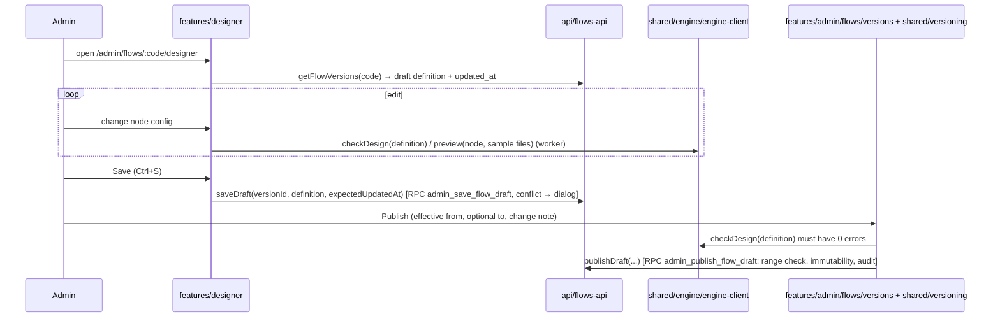
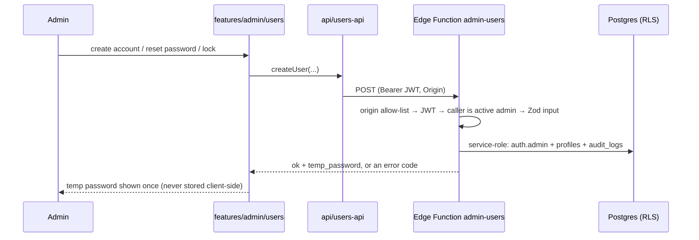

# 02 — Target Architecture

> The runtime architecture does **not** change (ADR-001, ADR-002). What changes is the module
> structure inside `apps/web/src`, the rules between modules, and how they are enforced.
> `src/` means `apps/web/src/`.

## 1. System view



Hard boundary (unchanged, non-negotiable): **file content exists only in the worker and in memory.**
Nothing from a file goes to `api`, logs, storage or the URL.

## 2. Layers and modules

| Layer | Folder | Responsibility | May contain |
|-------|--------|----------------|-------------|
| Composition | `src/app/` | Router, providers, service wiring, top-level layouts | React, route table |
| Features | `src/features/<name>/` | Screens and feature logic of one area | Pages, feature components, stores |
| Shared | `src/shared/` | Code used by ≥ 2 features that is not a design-system part | Auth core, engine client, versioning UI, hooks, i18n |
| Data access | `src/api/` | The only code that talks to Supabase | Client factory, one module per resource, error mapping, DB types |
| Design system | `src/ui/` | DS v3: tokens, components, layout, icons | React components with no app knowledge |
| Engine | `src/engine/` | Flow execution in the worker | Pure TypeScript, no DOM, no React |
| Schema package | `packages/flow-schema/` | Zod schemas of flow, slots, node configs | Zod only |
| Backend | `supabase/` | Schema, RLS, RPC, Edge Function, SQL tests | SQL, Deno |

Features (top-level folders under `src/features/`): `auth`, `runner`, `designer`, `admin`.
`admin` is one module with sub-folders `users`, `flows`, `ref-tables`, `ui-text`.

## 3. Dependency rules

`✓` allowed, `✗` forbidden. Enforced by ESLint `no-restricted-imports` zones (T-P0-05, T-P1-05).

| From ↓ / To → | app | own feature | other feature | shared | api | ui | engine public | engine internals | flow-schema |
|---|---|---|---|---|---|---|---|---|---|
| `app` | ✓ | ✓ (any) | ✓ (any) | ✓ | ✓ | ✓ | ✓ | ✗ | ✓ |
| `features/X` | ✗ | ✓ | ✗ | ✓ | ✓ | ✓ | ✓ | ✗ | ✓ |
| `shared` | ✗ | ✗ | ✗ | ✓ | ✓ | ✓ | ✓ | ✗ | ✓ |
| `api` | ✗ | ✗ | ✗ | ✗ | ✓ | ✗ | types only | ✗ | ✓ |
| `ui` | ✗ | ✗ | ✗ | ✗ | ✗ | ✓ | ✗ | ✗ | ✗ |
| `engine` | ✗ | ✗ | ✗ | ✗ | ✗ | ✗ | ✓ | ✓ | ✓ |

Definitions:

- **Engine public surface** = exactly two modules: `src/engine/protocol.ts` (worker message types, `formatIssue`, design/preview result types, `textVars`/`sameVars`) and `src/engine/formula/public.ts` (`FUNCTIONS`, `FUNCTION_GROUPS`, `escapeRef`, `toDisplay`, `toStored`, `FormulaError`, types `RefColumn`, `FormulaParamDef`). Everything else under `src/engine/` is internal.
- One exception: `src/shared/engine/engine-client.ts` references `../../engine/worker.ts` as the worker URL and imports `type EngineApi` from it.
- `ui` may import third-party packages `react`, `react-dom`, `react-i18next` (hook only), `@tanstack/react-table`, `@tanstack/react-virtual`. It never imports the i18n instance, Supabase, or the router. Navigation is passed in as `href` / `onNavigate` props or a `linkComponent` prop.
- Only `src/api/**` and `src/app/services.ts` may import `@supabase/supabase-js` or call `getSupabase()`. `shared/auth` receives the client through its constructor (type import only).
- Test files follow the rules of the folder they live in.

## 4. Target folder structure

```
HR-System/
├─ CLAUDE.md                         operating manual for the executor (English, short)
├─ README.md                         human-facing overview + setup + backup/restore (Vietnamese)
├─ .claude/
│  ├─ settings.json                  permissions (deny) + hooks
│  ├─ hooks/                         protect-files.sh, verifier-test-only.sh, format.sh
│  ├─ rules/                         core.md (always) · engine.md · ui.md · api-db.md · testing.md · docs.md (path-scoped)
│  ├─ agents/                        implementer.md · verifier.md
│  └─ skills/                        execute-task · clarify · add-node · ui-screen · db-migration · release
├─ docs/
│  ├─ MEMORY.md                      decision journal (Vietnamese, append-only, not auto-loaded)
│  ├─ MEMORY-archive.md              superseded decisions
│  ├─ redesign/                      00 … 08 + 05-decisions/ (source of truth for design)
│  └─ archive/                       spec.md, PLAN.md, HANDOFF.md, design-reference.md, patches/ (frozen reference)
├─ apps/web/
│  ├─ index.html, e2e-showcase.html, vite.config.ts, bundle-budget.json, build/, scripts/, public/
│  └─ src/
│     ├─ main.tsx
│     ├─ index.css                   fonts + base layer; imports ui/theme.css
│     ├─ app/
│     │  ├─ App.tsx  router.tsx  services.ts  RootLayout.tsx  AppShell.tsx  UserMenu.tsx  scroll-frame.ts
│     ├─ features/
│     │  ├─ auth/                    LoginPage.tsx  ChangePasswordPage.tsx  AuthLayout.tsx  idle/{IdleLogout.tsx,idle-timer.ts,idle-signout.ts}
│     │  ├─ runner/                  FlowListPage.tsx  RunPage.tsx  ResultPage.tsx  components/{SlotCard,RunProgress,ValidationReport,ResultTable}.tsx
│     │  │                           run-store.ts  run-context.tsx  readiness.ts  run-log.ts  local-flow-source.ts
│     │  ├─ designer/                DesignerPage.tsx  DesignerEditor.tsx  editor/{use-canvas-graph,use-commands,use-draft-save,use-shortcuts}.ts
│     │  │                           canvas/  panels/{ConfigPanel,DataPanel,Palette,StatusBar,ConnectMenu}.tsx
│     │  │                           nodes/{registry.ts,<node-type>.tsx …}  forms/{SlotForm,ParamsForm,fields}.tsx
│     │  │                           formula/  sql/  catalog.ts  model.ts  connect-targets.ts  issue-text.ts  preview-signature.ts  use-design-check.ts  i18n.ts  designer.css
│     │  └─ admin/
│     │     ├─ AdminLayout.tsx  nav.ts
│     │     ├─ users/                UsersPage.tsx  GroupsPage.tsx  AssignmentsPage.tsx  {CreateUserDialog,EditUserDialog,TempPasswordDialog,GroupDialog}.tsx
│     │     ├─ flows/                FlowsPage.tsx  ImportFlowDialog.tsx  CreateFlowDialog.tsx  versions/{FlowVersionsPage,DiffView,Timeline}.tsx  versions/version-diff.ts
│     │     ├─ ref-tables/           (current files, restyled)
│     │     └─ ui-text/              (current files, restyled)
│     ├─ shared/
│     │  ├─ auth/                    auth-service.ts  auth-context.tsx  guard.ts  credentials.ts  session-revoke.ts
│     │  ├─ engine/                  engine-client.ts  activity.ts
│     │  ├─ versioning/              as-of.ts  version-status.ts  version-ranges.ts  PublishForm.tsx  EndDateForm.tsx
│     │  ├─ flow/                    ParamsCard.tsx
│     │  ├─ hooks/                   use-resource.ts
│     │  ├─ i18n/                    i18n.ts  ui-text.ts
│     │  └─ util/                    format.ts  download.ts
│     ├─ api/
│     │  ├─ supabase.ts  env.ts  database.types.ts  client.ts  errors.ts
│     │  ├─ users-api.ts  groups-api.ts  assignments-api.ts  flows-api.ts
│     │  ├─ ref-tables-api.ts  ui-text-api.ts  runs-api.ts  flow-source.ts
│     ├─ ui/
│     │  ├─ index.ts                 public barrel
│     │  ├─ theme.css  tokens/{primitives.css,semantic.css,density.css}
│     │  ├─ Button.tsx  IconButton.tsx  Chip.tsx  Card.tsx  Callout.tsx  Text.tsx
│     │  ├─ form/      FormField.tsx  FieldGrid.tsx  TextInput.tsx  Textarea.tsx  Checkbox.tsx  RadioGroup.tsx  Select.tsx  DatePicker.tsx  MonthPicker.tsx  FileDrop.tsx
│     │  ├─ overlay/   Popover.tsx  Tooltip.tsx  InfoTip.tsx  Menu.tsx  Dialog.tsx  ConfirmDialog.tsx  Toast.tsx
│     │  ├─ layout/    AppFrame.tsx  SideNav.tsx  PageShell.tsx  PageHeader.tsx  Section.tsx  Toolbar.tsx  StickyActionBar.tsx  Tabs.tsx  Stepper.tsx  SplitPane.tsx
│     │  ├─ data/      DataTable.tsx  DataGrid.tsx  KpiCard.tsx  EmptyState.tsx  ErrorState.tsx  Skeleton.tsx  ProgressBar.tsx
│     │  ├─ icons/index.tsx
│     │  ├─ logic/     popover-position.ts  select-logic.ts  menu-logic.ts  tabs-logic.ts  calendar.ts  toast-store.ts
│     │  └─ __tests__/ ds-v3.test.ts  v3-scope.ts  …
│     ├─ engine/                     unchanged internally; + formula/public.ts, core/text-vars.ts
│     ├─ locales/{vi,en}/
│     └─ showcase/                   living style guide (E2E build only)
├─ packages/flow-schema/             unchanged
├─ supabase/                         unchanged layout; new migrations only via the db-migration skill
├─ e2e/                              user/ admin/ designer/ engine/ ui/ support/ __screenshots__/
├─ fixtures/  vendor/  scripts/  .github/workflows/
```

Folders removed at the end of the refactor: `src/components/`, `src/lib/`, `docs/patches/` (moved), root-level `docs/spec.md`, `docs/PLAN.md`, `docs/HANDOFF.md`, `docs/design-reference.md` (moved).

## 5. Data flow — three most important use cases

Call names in the diagrams are descriptive. The real worker API is `EngineApi` in
`src/engine/worker.ts`; the real server calls are the RPC / table names shown in brackets.

### 5.1 Run a flow (User)



### 5.2 Edit and publish a flow version (Admin)



### 5.3 Admin account management



## 6. Cross-cutting concerns

### 6.1 Error handling

| Source | Representation | Shown as |
|--------|----------------|----------|
| Engine | `EngineError` → `EngineErrorInfo { messageKey, params, nodeId? }` (i18n key, never raw data) | Localised text at the node / file / row; run log stores the **key** only |
| API | `ApiError { key: ApiErrorKey }` thrown by every `api/*` function (`api/errors.ts` maps Postgres codes, PostgREST and Edge Function results to keys) | `t('errors.<key>')` in a `Callout` or toast |
| Auth | `AuthErrorKey` (`shared/auth/credentials.ts`) | Field error on the form |
| UI crash | Route-level `ErrorBoundary` per lazy route | `ErrorState` with reload action |

Rules: no raw `error.message` from the server is rendered; no thrown string; every user-visible error is an i18n key with params; labels never contain internal keys or config paths.

### 6.2 Logging

- Client: no `console.*` in `src/engine/**` (lint error). Outside the engine, `console.error` is allowed only inside the route `ErrorBoundary`, without file content.
- Server: `run_logs` (metadata, see 03 §4.7) and `audit_logs` (who did what to which entity; diff contains configuration values only).
- No telemetry, no third-party script, no analytics.

### 6.3 Configuration

| Item | Where | Notes |
|------|-------|-------|
| `VITE_SUPABASE_URL`, `VITE_SUPABASE_ANON_KEY` | Cloudflare Pages env / `apps/web/.env.local` | Public values. `api/env.ts` refuses a service-role or `sb_secret_` key. |
| `VITE_FLOW_SOURCE=local` | dev only | Ignored when `import.meta.env.PROD` |
| CSP and security headers | `apps/web/public/_headers` | `connect-src` = app + the Supabase project + `blob:`. Changing it needs an owner decision. |
| Edge Function `ALLOWED_ORIGINS` | Supabase function secret | Exact origins |
| `SUPABASE_DB_URL`, `BACKUP_PASSPHRASE` | GitHub Actions secrets | Used only by `backup.yml`, `db-tests.yml` |
| Bundle limits | `apps/web/bundle-budget.json` | Start-up JS ≤ 240 KiB gzip; CSS limit see ADR-005 |

### 6.4 Authentication and authorisation

- Sign-in: username + password (username mapped to a synthetic email), forced change on first sign-in, session in `sessionStorage`, idle sign-out after 8 h.
- Roles: `admin`, `user` (`profiles.role`), plus `is_active`.
- Enforcement points, in order of authority:
  1. **Postgres RLS + RPC checks** — the only real control (`private.is_admin()`, `private.can_access_flow()`, `private.can_run_version()`).
  2. Edge Function `admin-users` — verifies caller is an active admin before using the service role.
  3. Router guard (`shared/auth/guard.ts`, `beforeLoad` on `/admin`) — UX only; prevents loading admin chunks.
- Least privilege table: see 03 §6.

### 6.5 State management

| Kind of state | Mechanism |
|---------------|-----------|
| Server data in a screen | `useResource(loader)` from `shared/hooks/use-resource.ts` → `{ data, error, loading, reload }` (ADR-004) |
| Session / identity | `AuthService` + React context (`shared/auth`) |
| Run session (files, validation, progress, result handles) | `RunStore` class + `useSyncExternalStore` (`features/runner`) |
| Designer document + undo history | Pure functions in `features/designer/model.ts` (`history`, `commit`, `undo`, `redo`); state held by `DesignerEditor.tsx` |
| Dialog / form state | Local `useState` in the dialog component |
| Toasts | `ui/logic/toast-store.ts` |

No global store library. No data persisted in `localStorage` / IndexedDB except the auth session in `sessionStorage`.

## 7. Performance and bundle rules

- Start-up JS (entry + modulepreload) ≤ 240 KiB gzip. Monaco, React Flow, DuckDB, SheetJS, ExcelJS must stay out of it (build check).
- Heavy UI parts are imported by path, not through the `ui` barrel: `ui/data/DataGrid` (TanStack Table + Virtual).
- Every admin route and the Designer are lazy routes (`lazyRouteComponent`).
- Engine code is only in the worker chunk; the two public engine modules are small and tree-shakable.

## 8. Decisions, assumptions, open questions

| ID | Type | Statement |
|----|------|-----------|
| D-02-1 | DECISION | Runtime architecture unchanged; refactor is structural (ADR-001). |
| D-02-2 | DECISION | Six layers with the matrix in §3, enforced by ESLint (ADR-003). |
| D-02-3 | DECISION | `api/` is the only Supabase caller; no query library (ADR-004). |
| D-02-4 | DECISION | `admin` stays one feature module with four sub-folders. |
| A-02-1 | ASSUMPTION | Rolldown tree-shakes the two engine public modules so the start-up JS does not grow; the bundle check in `pnpm build` proves or disproves it in T-P0-05. |
| Q-02-1 | OPEN QUESTION | None. |
