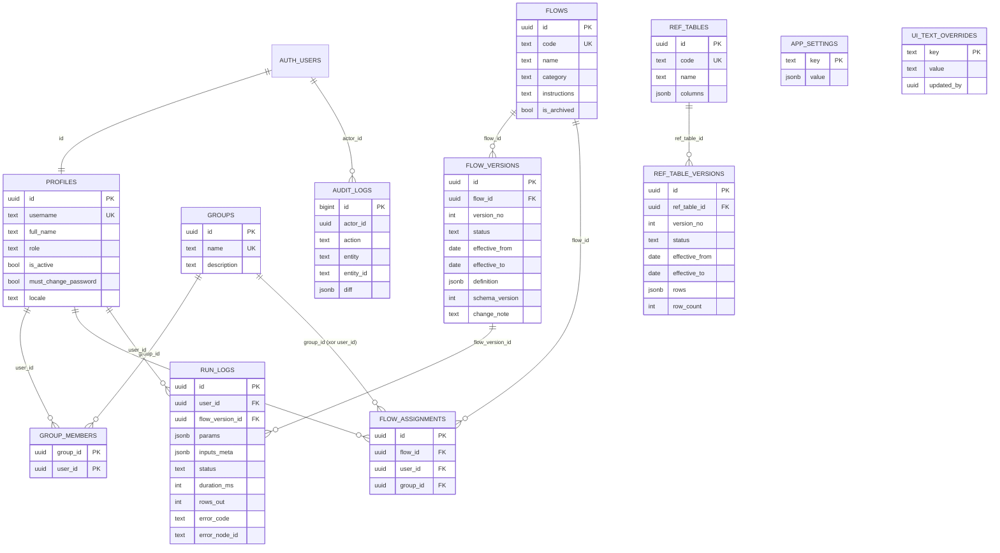
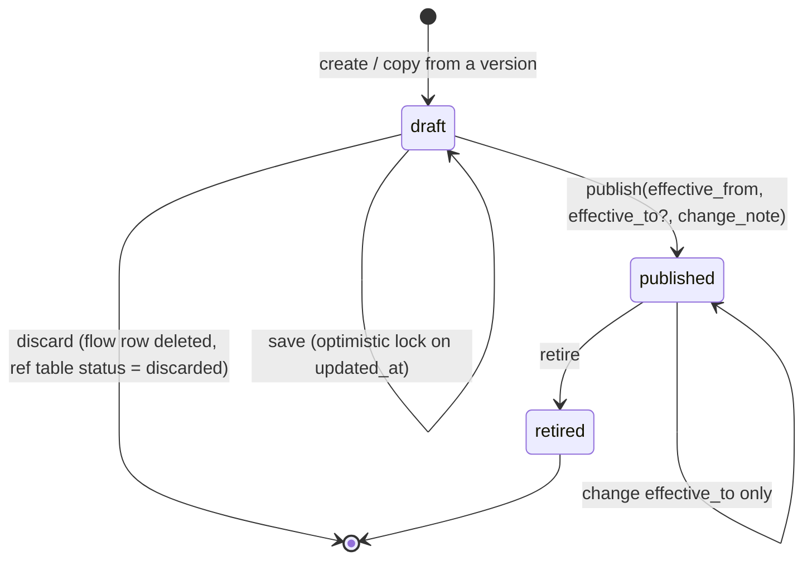

# 03 — Domain and Data Model

> The refactor makes **no schema change** and **no behaviour change**. This document records the
> model as implemented (source: `supabase/migrations/*.sql`, `packages/flow-schema/src/*.ts`,
> `apps/web/src/engine/`), so future work has one reference.
> Node-level behaviour (each node's config and semantics, the 41 formula functions, validation
> messages) stays in the frozen reference `docs/archive/spec.md` §8–§14, §24, §27, §34.

## 1. Domain glossary

| Term | Meaning |
|------|---------|
| Flow | A named data process identified by `code`; has versions |
| Flow version | One immutable (once published) definition of a flow, valid for an effective date range |
| Flow definition | JSON DAG: `params`, `inputSlots`, `nodes`, `edges` (`packages/flow-schema/src/flow.ts`) |
| Input slot | Declares one kind of uploaded file: sheet, header row, columns (aliases, type, rules), multi-file |
| Node | One step; type `group.name` (e.g. `transform.join`); implemented by an engine plugin |
| Run | One execution of a flow version on local files; leaves a metadata-only run log |
| As-of date | The date used to choose the flow version (and later reference-table versions) |
| Reference table | Admin-maintained lookup data without personal data, versioned by effective date |
| Assignment | Grants a user or a group the right to run a flow |

## 2. Entities (server)



### Field constraints (as implemented)

| Table | Field | Type / rule |
|-------|-------|-------------|
| profiles | `username` | `^[a-z0-9][a-z0-9._-]{1,30}[a-z0-9]$`, unique |
| profiles | `full_name` | ≤ 120 chars |
| profiles | `role` | `admin` \| `user` |
| profiles | `locale` | `vi` \| `en` |
| groups | `name` | 1–80 chars (trimmed), unique |
| flows | `code` | `^[a-z0-9][a-z0-9-]{1,62}[a-z0-9]$`, unique |
| flows | `name` / `description` / `category` / `instructions` | ≤ 160 / 1000 / 80 / 2000 chars |
| flow_versions | `status` | `draft` \| `published` \| `retired` |
| flow_versions | `definition` | JSON object, ≤ 1 MiB (`pg_column_size`) |
| flow_versions | `effective_to` | null or `> effective_from` |
| flow_versions | uniqueness | `(flow_id, version_no)`; one draft per flow; published ranges of one flow never overlap (`daterange(from, to, '[)')` exclusion) |
| flow_assignments | target | exactly one of `user_id`, `group_id` |
| run_logs | `params` | flat scalar map, ≤ 20 keys |
| run_logs | `inputs_meta` | array ≤ 50 of `{ slot, rows, files: [{ sha256, size }] }`, ≤ 200 files per slot, no other keys |
| run_logs | `status` | `succeeded` \| `failed` \| `cancelled` |
| run_logs | `error_code` | i18n key `^[A-Za-z][A-Za-z0-9_.]{0,99}$` — never raw text |
| audit_logs | `action`, `entity` | `^[a-z_.]{1,64}$`, `^[a-z_]{1,64}$` |
| ref_tables | `code` | `^[A-Z][A-Z0-9_]{1,63}$`, unique |
| ref_tables | `columns` | JSON validated by `private.ref_columns_valid` (key, title, type, file header, key flag) |
| ref_table_versions | `status` | `draft` \| `published` \| `retired` \| `discarded` |
| ref_table_versions | `rows` | JSON array ≤ 50,000 rows and ≤ 5 MiB |
| ui_text_overrides | `key` | `<namespace>:<i18n key>`, ≤ 200 chars |
| ui_text_overrides | `value` | null (= default) or ≤ 2000 chars, non-blank, no `<tag` |

## 3. Entities (client only, never stored on the server)

| Entity | Lives in | Notes |
|--------|----------|-------|
| Uploaded file bytes, parsed tables | Worker memory | Released on new run / tab close |
| Validation report, result tables, KPIs | Worker memory + React state | Shown on screen, downloadable |
| Designer sample files | Worker memory | Preview only |
| Auth session tokens | `sessionStorage` key `hrflow.auth` | Only item in browser storage |

Flow definition shape (`FlowDefinitionSchema`): `schemaVersion: 1`, `params[]` (`key`, `label`,
`type` ∈ string|number|date|month|boolean|select, `required`, `log?`, `isAsOfDate?`, `options?`),
`inputSlots[]`, `nodes[]` (`id`, `type`, `label?`, `config`), `edges[]` (`from`, `fromPort?`, `to`,
`toPort?`), `ui?`. Invariants: unique node ids, edges reference existing nodes, unique slot keys,
acyclic graph.

## 4. Business rules and calculations

### 4.1 Version lifecycle



- Published versions are immutable except `effective_to` and the transition to `retired`.
- Rollback = publish a new version whose content is copied from an old one.
- `version_no` = max(existing) + 1 within the flow; a discarded flow draft frees its number.

### 4.2 Effective-date resolution

A published version **applies** on date `d` when
`effective_from <= d AND (effective_to IS NULL OR effective_to > d)` — the range is half-open
`[effective_from, effective_to)`.

`d` = value of the parameter flagged `isAsOfDate` (a `month` parameter means its **first day**,
e.g. `2026-09` → `2026-09-01`; logic in `shared/versioning/as-of.ts`), or today (browser local
date) when the flow has no such parameter or it is not filled in.

Worked example — flow `payroll-timesheet`:

| Version | effective_from | effective_to | Applies on 2026-03-31 | on 2026-04-01 | on 2026-09-15 |
|---------|----------------|--------------|-----------------------|---------------|---------------|
| v1 | 2026-01-01 | 2026-04-01 | yes | no | no |
| v2 | 2026-04-01 | null | no | yes | yes |

Publishing v3 from 2026-07-01 while v2 is open-ended is rejected for overlap unless the publish
call asks to close the previous version, which sets v2 `effective_to = 2026-07-01`.

### 4.3 Compare (`control.compare`)

For each metric with `left`, `right`, `tolerance` (decimal, default 0):

```
diff      = right − left          (decimal arithmetic, never float)
mismatch  = |diff| > tolerance    (|diff| == tolerance is a match)
blank     = 0 when nullAsZero is true (default); the cell is still shown blank in the output
```

Keys are matched after normalisation (4.4). A key present on one side only goes to
`only_left` / `only_right`.

Worked example (tolerance 0.5 for work days, 0 for overtime):

| Key | Work days L | Work days R | diff | OT L | OT R | diff | Result |
|-----|-------------|-------------|------|------|------|------|--------|
| NV001 | 22 | 22.5 | 0.5 | 4 | 4 | 0 | match (0.5 is not > 0.5) |
| NV002 | 22 | 21 | −1 | (blank) | 0 | 0 | mismatch on work days |
| nv003␠ | 20 | — | — | — | — | — | joins `NV003` after normalisation |

### 4.4 Key normalisation

`normalizeKeyPart(v)` = NFC → collapse whitespace runs to one space → trim → lowercase.
Used by `control.compare`, the slot rule `unique`, and (default on, Admin can switch off)
`transform.join`, `transform.dedupe`, `transform.filter`. The same semantics exist in SQL
(`hrflow_norm_key`); a change on one side must change the other and its equivalence test.

### 4.5 Numbers, dates, text

| Rule | Detail |
|------|--------|
| Decimal | Money and day counts use `big.js` in TS and `DECIMAL(38,10)` in DuckDB; decimals cross to the UI as strings |
| Rounding | `ROUND` is half away from zero (Excel behaviour) |
| Blank metric cell | Treated as 0 in arithmetic, `""` in concatenation; a formula that is only a column reference returns blank for a blank cell |
| Text column | Takes the text Excel displays (keeps `00123`) |
| Date column | Always accepts a real Excel date cell regardless of the configured text format |
| Ambiguous numeric text (`"1,500"`) | Warning |
| Result file name | `month` parameter → `YYYY-MM`; `date` parameter → `YYYY-MM-DD` |
| Sort | Vietnamese collation (`Intl.Collator('vi')`); `min`/`max` on text use binary order |

### 4.6 Input validation (file check before a run)

| Case | Outcome |
|------|---------|
| Missing required column / missing key column | 1 error ("missing column"), no per-row errors |
| Two columns matching the same required column | error |
| Header present, no data rows | warning |
| Duplicate key within a slot (after normalisation), also across files of the slot | error on every file involved |
| Row whose key cell holds a configured skip text (e.g. "TỔNG CỘNG") | skipped |
| `.csv` | not accepted (only `.xlsx`, `.xls`) |
| Archive limits | 2 GiB per entry; ratio 1:200 for entries > 16 MiB; per-file budget |

### 4.7 Run log content (data minimisation)

Stored: user id, flow version id, parameters flagged for logging, per slot `{ slot key, row count,
files: [{ sha256 of file NAME, byte size }] }`, status, duration, rows out, error **key**, error
node id, flat client info. Never stored: file names, cell values, raw error text.

### 4.8 Reference tables

- Columns are defined at table level; every version uses the current column set.
- Each version ≤ 50,000 rows and ≤ 5 MiB; draft edited in the grid or replaced by an Excel import (read in the worker).
- Import warns when a column name looks like personal data; the Admin must confirm "not personal data"; the confirmation is audited.
- Same lifecycle and effective-date rule as flows (4.1, 4.2).

## 5. Validation rules by layer

| Layer | Validates | Mechanism |
|-------|-----------|-----------|
| Schema package | Flow definition, slot, node config shape | Zod (`packages/flow-schema`) |
| Engine planner | Cross-node rules (slot exists, columns exist, types) | `checkConfig`, `inferSchema` → `EngineError` with i18n key |
| Designer | Same checks live, labelled by form field | `engine/design.ts` via worker → `issue-text.ts` |
| Database | Sizes, formats, ranges, lifecycle, ownership | CHECK constraints, exclusion constraints, guard triggers, RPC |
| Edge Function | Request body | Zod |
| UI forms | Required / format before submit | `FormField` error slot; never the only check |

## 6. Access control matrix (RLS, as implemented)

| Table | `user` (active) | `admin` | `anon` |
|-------|-----------------|---------|--------|
| profiles | read own; update own `full_name`, `locale` | read all; writes through Edge Function | — |
| groups, group_members | read own memberships | all | — |
| flows | read flows assigned (directly or by group) that have a published version | all | — |
| flow_versions | read **published** versions of accessible flows | all (guard trigger still applies) | — |
| flow_assignments | read own | all | — |
| run_logs | read own; insert own for a runnable version | read all | — |
| audit_logs | — | read | — |
| app_settings | read | all | grant only; RLS returns no rows (keep-alive ping) |
| ui_text_overrides | read | read, insert, update | read `key`, `value` of edited rows |
| ref_tables, ref_table_versions | — (planned: read published versions used by assigned flows) | read, insert, update via RPC | — |

Service role is used only inside the Edge Function `admin-users`.

## 7. Audit logging

| Event | Recorded by | Content |
|-------|-------------|---------|
| Row changes on `groups`, `group_members`, `flows`, `flow_versions`, `flow_assignments`, `app_settings`, `ref_tables`, `ui_text_overrides` | Trigger `audit` → `private.audit_row` | actor, action, entity, id, config diff |
| Account create / reset / lock / role change | Edge Function | actor, target id, changed fields (no password) |
| Reference table version changes, "not personal data" confirmation | `private.audit_ref_version`, `private.audit_ref_no_personal_data` | actor, table, column names confirmed |
| UI text change | Trigger `private.set_ui_text_author` | author + time on the row (plus the generic audit row above) |
| Flow run | Client insert into `run_logs` | see 4.7 |

There is no compensation or personal HR data on the server, so there is nothing of that kind to
audit server-side. If decision 2A is ever reversed, this section must be redesigned first.

## 8. Migration strategy

The refactor needs **no table, column or policy change**. Two database tasks exist, both
metadata-only and reversible:

| Step | Action | Reversible by | Data loss risk |
|------|--------|---------------|----------------|
| M-1 (T-P0-03) | Run `db-tests.yml` (all files are `begin … rollback`) and `backup.yml` on the real DB | n/a (read-only / self-rolling-back) | none |
| M-2 (T-P0-04) | Record the 6 existing migration files in the migration-history table so tooling can detect drift | Removing the 6 rows | none (history table only) |
| M-3 (T-P0-04) | Compare `database.types.ts` with types generated from the real DB; fix the TS file only | git revert | none |

Rules for any future migration (procedure in the `db-migration` skill):

1. New file `supabase/migrations/<UTC timestamp>_<name>.sql`; never edit an applied file.
2. Additive first (new nullable column / new table), backfill, then switch code, then constrain. Removal is a separate later migration after one release.
3. New table: `revoke all … from public, anon, authenticated`, then explicit grants, `enable row level security`, policies, SQL test file in `supabase/tests/` wrapped in `begin … rollback`.
4. Run the SQL tests on the real DB (`db-tests.yml`) and the security advisor before merging to `main`.
5. Take a backup run (`backup.yml`, includes restore verification) before any migration that rewrites data.

## 9. Compliance flags (information only — not legal advice)

The owner decided on 2026-11-12 that this is a personal experiment and company IT / legal review is
skipped. If the tool is ever used with real colleagues' data in a company context, these points
need a qualified review against Vietnam's personal data protection rules (Decree 13/2023/NĐ-CP and
the Personal Data Protection Law in force from 2026 — verify the current text):

| # | Point | Where it arises |
|---|-------|-----------------|
| C-1 | Account data (`username`, `full_name`) and activity logs are personal data of the tool's users | `profiles`, `run_logs`, `audit_logs` |
| C-2 | That data is stored outside Vietnam (Supabase region Singapore) — cross-border transfer | Hosting |
| C-3 | HR files are processed on the user's device; the organisation still decides purpose and means of that processing | Whole product |
| C-4 | Reference tables rely on an Admin's declaration that they hold no personal data | `ref_table_versions.rows` |
| C-5 | Retention: `app_settings.run_log_retention_months` = 12 and `purge_run_logs()` exist; whether the purge is ever invoked is **UNVERIFIED**; `audit_logs` has no retention rule | `app_settings`, RPC |
| C-6 | Backups contain account and log data, encrypted with a passphrase held by the owner | `backup.yml` artifacts (90 days) |

## 10. Decisions, assumptions, open questions

| ID | Type | Statement |
|----|------|-----------|
| D-03-1 | DECISION | No schema change in the refactor; behaviour reference stays in `docs/archive/spec.md`. |
| D-03-2 | DECISION | Version lifecycle SQL stays duplicated for flows and reference tables (ADR-007). |
| A-03-1 | ASSUMPTION | The migration-history table on this project has the standard shape (`version`, `name`, `statements`); T-P0-04 checks before writing. |
| Q-03-1 | OPEN QUESTION | Who calls `purge_run_logs()` and how long `audit_logs` are kept (C-5) is not decided. Default until decided: nothing is purged automatically. |
