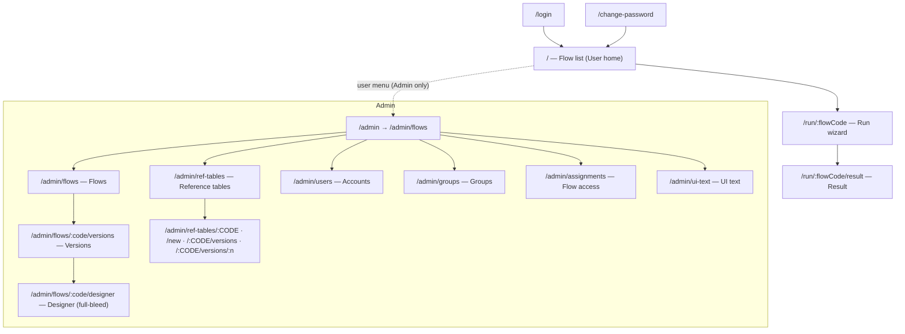

# 04 — UI / UX System (Design System v3)

> Owner decision 5C (2026-11-13): redesign the UI as **one shared system** so later development
> reuses it, does not drift, and is not re-coded.
> DS v3 replaces the v2 tokens in `apps/web/src/index.css` and the folder `src/components/`.
> UI language: Vietnamese (i18n keys). This document is in English; Vietnamese strings shown are
> existing labels from `src/locales/vi/common.json`.
> `src/` means `apps/web/src/`.

## 1. Principles

| # | Principle | Consequence |
|---|-----------|-------------|
| 1 | **One source for every visual value** | Values exist only in `src/ui/tokens/*.css`. Feature code uses semantic utilities or `ui/` components. A test fails on anything else. |
| 2 | **Semantic, not literal** | Feature code says `status-negative`, never `coral`. Changing the palette or adding a theme edits one file. |
| 3 | **Density is a mode, not an exception** | Two densities (`comfortable`, `compact`) set by one attribute on a layout container. No per-screen "dense" classes or allow-lists. |
| 4 | **Compose screens from page templates** | A screen picks one template (§7.1) and fills slots. It never writes its own page frame, table, form field, dialog, toast, popover or file input. |
| 5 | **Every data view has four states** | loading (skeleton), empty, error, success — provided by the component, not re-invented per screen. |
| 6 | **Work area first** | Canvas and data tables get the space; secondary panels collapse or resize. |
| 7 | **Keyboard and screen reader complete** | WCAG 2.1 AA; APG patterns for composite widgets. |

## 2. Information architecture



Changes from today:

| Change | Reason |
|--------|--------|
| `/admin` redirects to `/admin/flows` (was `/admin/users`) | Flows are the primary work object |
| `/admin/users` page split into three routes: users, groups, assignments | The single page is 1,003 lines with three unrelated tables (AUD-08) |
| Menu entries Dashboard, Templates, Logs **removed** until built | Unbuilt entries, truncated label (AUD-17) |
| All existing URLs keep working | No broken bookmark |

## 3. Navigation

- **Top bar** (all signed-in screens): app mark + name (link to `/`), area badge when in Admin, user menu at the right (`Quản trị` link for admins, change password, sign out). Height: 56 px.
- **Admin side navigation** (≥ 1024 px: fixed column 232 px; below: collapsed behind a menu button in the top bar). Grouped:

| Group heading (new i18n key) | Item (i18n key → current text) | Route |
|------------------------------|--------------------------------|-------|
| `admin.nav.group.flows` → "Luồng và dữ liệu" | `admin.nav.flows` → "Luồng xử lý" | `/admin/flows` |
| | `admin.nav.refTables` → "Bảng tham chiếu" | `/admin/ref-tables` |
| `admin.nav.group.people` → "Người dùng" | `admin.nav.accounts` (new) → "Tài khoản" | `/admin/users` |
| | `admin.nav.groups` (new) → "Nhóm" | `/admin/groups` |
| | `admin.nav.assignments` (new) → "Phân quyền luồng" | `/admin/assignments` |
| `admin.nav.group.system` → "Hệ thống" | `admin.nav.uiText` → "Cài đặt UI" | `/admin/ui-text` |

- **Designer**: full-bleed, no side navigation; its own toolbar with a back link to the versions page.
- **Wizard** (Run): `Stepper` + `StickyActionBar`; one primary action per step.
- Breadcrumb-style back link (`PageHeader.back`) on every second-level page.

## 4. Page inventory

Access: U = user, A = admin. Density: C = comfortable, K = compact. States: every page implements
loading / empty / error / success as listed.

| # | Route | Purpose | Access | Density | Template | Main `ui` parts | Loading | Empty | Error | Success |
|---|-------|---------|--------|---------|----------|-----------------|---------|-------|-------|---------|
| 1 | `/login` | Sign in | public | C | Auth | `Card`, `FormField`, `TextInput`, `Button`, `Callout` | button busy | — | field error / account locked callout | redirect |
| 2 | `/change-password` | Forced or voluntary change | U, A | C | Auth | same | button busy | — | field errors | toast + redirect |
| 3 | `/` | Flow list + recent runs | U, A | C | List | `PageHeader`, card grid, `DataTable` | card skeletons | `EmptyState` "no flow assigned" | `ErrorState` retry | cards + table |
| 4 | `/run/:flowCode` | Run wizard: params → files & check → run | U, A | C | Wizard | `Stepper`, `FormField`, pickers, `FileDrop`, `ProgressBar`, `StickyActionBar`, `DataGrid` (validation report) | page skeleton | — | not found / no version for date / engine crash `Callout` | step complete → next |
| 5 | `/run/:flowCode/result` | Result: conclusion, KPIs, sheets, download | U, A | C | Report | `PageHeader`, `KpiCard`, `Tabs`, `DataGrid`, `Button` | skeleton | "no result in memory" `EmptyState` with link back | `ErrorState` | KPIs + tables |
| 6 | `/admin/flows` | Flows list; create; import JSON | A | K | List | `PageHeader`, `Toolbar`, `DataTable`, `Dialog`, `FileDrop` | table skeleton | `EmptyState` + create action | `ErrorState` | table |
| 7 | `/admin/flows/:code/versions` | Versions, timeline, publish, retire, diff | A | K | Detail | `PageHeader`, `DataTable`, `Tabs`, `Dialog` with `PublishForm` / `EndDateForm`, diff view | skeleton | "no version" | `ErrorState` | table + timeline |
| 8 | `/admin/flows/:code/designer` | Flow Designer | A | K | Workbench | `SplitPane`, `Toolbar`, `Tabs`, `FormField`, `Select`, `DataGrid`, `FileDrop`, Monaco | Designer skeleton | empty canvas hint | conflict dialog, node issues inline | saved toast |
| 9 | `/admin/ref-tables` | Reference tables list | A | K | List | `DataTable`, `Dialog` | table skeleton | `EmptyState` + create | `ErrorState` | table |
| 10 | `/admin/ref-tables/new`, `/admin/ref-tables/:CODE` | Columns and metadata | A | K | Form | `FormField`, `FieldGrid`, `DataTable`, `Dialog` | skeleton | — | field errors | saved toast |
| 11 | `/admin/ref-tables/:CODE/versions` | Versions, publish, compare | A | K | Detail | as #7 | skeleton | "no version" | `ErrorState` | table |
| 12 | `/admin/ref-tables/:CODE/versions/:n` | Version data: draft grid edit, Excel import; read-only for published | A | K | Workbench-lite | editable grid (feature), `Toolbar`, `Dialog`, `FileDrop` | skeleton | empty draft hint | cell errors in place | saved toast |
| 13 | `/admin/users` | Accounts: create, edit, reset, lock | A | K | List | `DataTable`, `Dialog`, `RadioGroup`, `Checkbox` | table skeleton | — (always ≥ 1) | `ErrorState` | table |
| 14 | `/admin/groups` | Groups and members | A | K | List | `DataTable`, `Dialog` | table skeleton | `EmptyState` + create | `ErrorState` | table |
| 15 | `/admin/assignments` | Which user / group may run which flow | A | K | List | `DataTable`, `Select`, `Dialog` | table skeleton | `EmptyState` | `ErrorState` | table |
| 16 | `/admin/ui-text` | Override UI texts | A | K | List | `Toolbar`, `DataTable` (paged 100), `Dialog` | table skeleton | "no match" | `ErrorState` | table |

Sub-routes of #9–#12 are dispatched by `src/features/admin/ref-tables/RefTablesRoute.tsx` under the
single splat route `/admin/ref-tables/$` (unchanged).

## 5. Design tokens

### 5.1 Architecture

```
src/ui/tokens/primitives.css   :root { --p-* }            raw palette and scales — never used outside tokens/
src/ui/tokens/semantic.css     :root { --ds-color-* … }   meaning → primitive (one block = one theme)
src/ui/tokens/density.css      :root, [data-density=…]    sizes, spacing, type per density (+ mobile media query)
src/ui/theme.css               @theme inline { … }        exposes semantic + density variables as Tailwind utilities
```

- `@theme inline` is required so a utility such as `h-ctl` compiles to `height: var(--ds-ctl-h)` and
  resolves at the element, inside whichever `[data-density]` container it sits in.
- Primitives are **not** in `@theme`; no utility exists for them.
- Adding a theme later (e.g. dark) = one more block in `semantic.css` under `[data-theme='…']`. Not built now.
- During the migration the v2 `@theme` block stays in `index.css`; v3 token names never collide with v2 names. T-P3-08 deletes v2.

### 5.2 Colour — semantic tokens (light theme)

Contrast ratios computed with the WCAG formula.

| Utility name (`bg-…` / `text-…` / `border-…`) | Value | Use | Contrast |
|---|---|---|---|
| `surface-page` | `#F6F7F9` | App background | — |
| `surface-card` | `#FFFFFF` | Cards, tables, dialogs, popovers, top bar | — |
| `surface-sunken` | `#F1F5F9` | Table header, neutral chip, skeleton, scrollbar track | — |
| `surface-inverse` | `#1F2A44` | Conclusion card, dark button | white text 14.26 |
| `surface-drop` | `#F3FBF8` | File drop zone | — |
| `fg-strong` | `#1F2A44` | Titles, labels, table header text | 14.26 on card · 13.30 on page |
| `fg-default` | `#334155` | Body text | 10.35 on card · 9.66 on page |
| `fg-muted` | `#475569` | Secondary text, placeholders | 7.58 on card · 7.07 on page · 6.92 on sunken |
| `fg-on-action` | `#FFFFFF` | Text on action / inverse surfaces | see action rows |
| `fg-link` | `#0F766E` | Links | 5.47 on card |
| `line-subtle` | `#E2E8F0` | Card borders, table rules (decorative) | — |
| `line-control` | `#64748B` | Input / select / checkbox / drop-zone borders | 4.76 on card (≥ 3:1 required) |
| `line-strong` | `#1F2A44` | Outline button border, selected nav marker | 14.26 |
| `action-primary` / `-hover` | `#0F766E` / `#115E59` | Primary button, focus ring, checked controls | white 5.47 / 7.58 |
| `action-neutral` / `-hover` | `#1F2A44` / `#334155` | Dark button | white 14.26 / 10.35 |
| `action-danger` / `-hover` | `#C2410C` / `#9A3412` | Destructive button | white 5.18 / 7.31 |
| `status-positive-fg` / `-bg` | `#0F766E` / `#DDF5EF` | Match, success, published | 4.79 |
| `status-negative-fg` / `-bg` | `#C2410C` / `#FFF1E7` | Error, mismatch, locked | 4.68 |
| `status-warning-fg` / `-bg` | `#B45309` / `#FFF8E1` | Warning, draft | 4.73 |
| `status-info-fg` / `-bg` | `#1D4ED8` / `#EAF2FF` | Info, admin badge | 5.95 |
| `status-neutral-fg` / `-bg` | `#334155` / `#F1F5F9` | Retired, inactive | 9.45 |
| `accent-teal` / `-coral` / `-amber` / `-blue` | `#14B8A6` / `#F97362` / `#FBBF24` / `#3B82F6` | Decoration only (KPI top bar, illustrations). Never text, never under text. | — |

Tone type shared by components: `Tone = 'positive' | 'negative' | 'warning' | 'info' | 'neutral'`.

### 5.3 Typography

Font: **Be Vietnam Pro**, self-hosted, weights **400 and 600 only** (500 and 700 files are removed in T-P3-08).
Mono stack for `text-mono`: `ui-monospace, 'Cascadia Mono', Consolas, monospace` (Monaco keeps its own font).

| Utility | Role | Comfortable (size/line) | Compact | Weight | Mobile < 768 (comfortable) |
|---------|------|-------------------------|---------|--------|-----------------------------|
| `text-display` | KPI number | 40/44 | 32/36 | 600 | 32/36 |
| `text-h1` | Page title | 28/36 | 24/32 | 600 | 24/32 |
| `text-h2` | Section, dialog title | 20/28 | 18/24 | 600 | 18/24 |
| `text-h3` | Card title, empty-state title | 16/24 | 14/20 | 600 | — |
| `text-ui` | Body, input text, table cell | 16/24 | 14/20 | 400 | — |
| `text-ui-strong` | Label, button, table header, emphasis | 16/24 | 14/20 | 600 | — |
| `text-small` | Caption, helper, meta | 14/20 | 13/18 | 400 | — |
| `text-overline` | Eyebrow above a title | 12/16, uppercase, letter-spacing 0.06em | same | 600 | — |
| `text-mono` | SQL, formula, JSON, code | 14/20 | 13/18 | 400 | — |

Nine styles (v2 had 15). Titles are sentence case. User-named titles are one line with ellipsis and full text on hover/focus (`OneLine`).

### 5.4 Size and spacing

Fixed scale for ad-hoc gaps and padding (Tailwind numeric utilities): **4 · 8 · 12 · 16 · 24 · 32 · 48 · 64 px** only (`1 2 3 4 6 8 12 16`).

Density-aware tokens:

| Utility stem | Meaning | Comfortable | Compact |
|--------------|---------|-------------|---------|
| `ctl` (`h-ctl`, `min-h-ctl`) | Control height: input, select, picker, standard button | 44 | 36 |
| `ctl-sm` | Small button, icon button | 36 | 28 |
| `tr` | Table body row min height | 48 | 36 |
| `th` | Table header row height | 44 | 32 |
| `gutter` (`px-gutter`) | Page side padding | 32 (mobile 16) | 24 |
| `page-y` | Space above page header | 24 (mobile 16) | 16 |
| `block` (`gap-block`) | Between blocks of a page | 24 (mobile 16) | 16 |
| `group` (`gap-group`) | Between fields / blocks inside a card | 16 | 12 |
| `item` (`gap-item`) | Between items on one row | 8 | 8 |
| `pad` (`p-pad`) | Card / dialog padding | 24 (mobile 16) | 16 |
| `cell` (`px-cell`) | Table cell horizontal padding | 16 | 12 |

Page widths (`PageShell width`): `content` 1280 px, `narrow` 480 px, `fluid` 100 %, `bleed` (no padding).

### 5.5 Shape, elevation, motion, layers

| Token | Value | Use |
|-------|-------|-----|
| `rounded-chip` | 6 px | Chips, tags, nav items |
| `rounded-control` | 8 px | Buttons, inputs, selects, menu items |
| `rounded-container` | 12 px | Cards, dialogs, popovers, toasts, canvas nodes |
| `rounded-full` | 999 px | Status pills, avatars, scrollbar thumb |
| elevation 0 | 1 px `line-subtle`, no shadow | Cards, tables |
| `shadow-overlay` | `0 8px 28px rgba(31,42,68,.12)` | Popover, dialog, toast, menu |
| `shadow-raised` | `0 -1px 0 #E2E8F0, 0 -8px 24px rgba(31,42,68,.06)` | Sticky action bar |
| motion | 120 ms (hover, press), 200 ms (overlay enter); `ease-out`; none under `prefers-reduced-motion` | — |
| focus ring | 3 px `action-primary`, offset 2 px, on every focusable element | — |
| z-layers | `z-sticky` 10 · `z-dropdown` 20 · `z-overlay` 30 · `z-modal` 40 · `z-toast` 50 | No other z-index value |
| breakpoints | `md` 768 · `lg` 1024 · `xl` 1280 | User screens work from 390 px; Admin and Designer from 1024 px |
| scrollbar | 10 px, track `surface-sunken`, thumb `line-control`, hover `fg-strong`, gutter always reserved | Every scroll area |

### 5.6 Density

- Set by `data-density="comfortable" | "compact"` on a layout container; components never take a `dense` prop.
- Defaults: `AppFrame` = comfortable. `features/admin/AdminLayout` and the Designer set `compact`.
- Overlays inherit the density of the frame that opened them: `Dialog` is a native `<dialog>` rendered in place (top layer, same DOM subtree) and `Popover` renders next to its anchor. **No portal to `<body>`** — a portal would lose the density variables.
- Rule for future screens: User-facing "read and decide" screens → comfortable; Admin, Designer and data grids → compact.

## 6. Component library (`src/ui/`)

All components: typed props, `className` is **not** accepted (no style escape hatch) except on
layout primitives marked †; no app imports; text passed in as props or read from `common:ui.*`
i18n keys for built-in labels (close, clear, search, previous / next month…).

### 6.1 Primitives

| Component | Props (required **bold**) | Notes |
|-----------|---------------------------|-------|
| `Button` | **`children`**, `variant?: 'primary' \| 'neutral' \| 'outline' \| 'text' \| 'danger'` (default `outline`), `size?: 'md' \| 'sm'`, `busy?`, `disabled?`, `type?`, `onClick?`, `iconStart?` | One `primary` per view region. `busy` shows a spinner and blocks clicks. |
| `LinkButton` | same visual props + **`href`**, `linkComponent?` | For navigation styled as a button |
| `IconButton` | **`label`** (accessible name + tooltip), **`icon`**, `size?`, `variant?: 'text' \| 'outline'`, `onClick?`, `disabled?` | Square `ctl-sm` |
| `Chip` | **`tone: Tone`**, **`children`**, `shape?: 'pill' \| 'square'` | Status only; not interactive |
| `Card` | **`children`**, `title?`, `actions?`, `padded?` (default true), `tone?: 'default' \| 'inverse'` | Border, no shadow |
| `Callout` | **`tone: Tone`**, **`children`**, `title?`, `action?` | Inline message block; `role="alert"` for `negative` |
| `OneLine` | **`text`**, `as?` | Single line + ellipsis + full text on hover/focus |
| `MiddleCut` | **`text`** | File names: cut in the middle |
| `Overline` | **`children`**, `tone?` | Eyebrow text |
| `Icon*` | — | All SVG icons live in `ui/icons/index.tsx`; 20 px grid, `currentColor` |

### 6.2 Form

| Component | Props | Notes |
|-----------|-------|-------|
| `FormField` | **`label`**, **`children`** (one control), `hint?` (shown behind an `InfoTip`), `error?`, `required?`, `note?` (always-visible status line) | Wires `id`, `aria-describedby`, `aria-invalid`. Label is one line. |
| `FieldGrid` † | **`children`**, `columns?: 1 \| 2 \| 3` (max) | Reduces columns until every label fits on one line; never leaves a lone field on the last row |
| `TextInput` | `value`, `onChange`, `type?: 'text' \| 'password' \| 'number' \| 'search'`, `placeholder?`, `disabled?`, `invalid?` | Number: no spin buttons |
| `Textarea` | `value`, `onChange`, `rows?` | — |
| `Checkbox` | **`label`**, `checked`, `onChange`, `hint?`, `disabled?` | Label one line; detail in `hint` |
| `RadioGroup` | **`label`**, **`options: {value,label,hint?}[]`**, `value`, `onChange`, `direction?` | APG radio group |
| `Select` | **`options`** or **`groups`**, `value`, `onChange`, `searchable?`, `placeholder?`, `disabled?`, `invalid?` | No native `<select>`; diacritic-insensitive search |
| `DatePicker`, `MonthPicker` | `value` (ISO), `onChange`, `min?`, `max?`, `disabled?`, `invalid?` | Vietnamese labels; no native pickers |
| `FileDrop` | **`label`**, **`accept: string[]`**, `multiple?`, `files: {name,size}[]`, `onAdd(files: File[])`, `onRemove(index)`, `busy?`, `error?`, `compact?` | The **only** file input in the app; hides the native control; shows names with `MiddleCut` |

### 6.3 Overlay

| Component | Props | Notes |
|-----------|-------|-------|
| `Popover` | **`anchorRef`**, **`open`**, **`onClose`**, `placement?`, `role?`, `children` | Single positioning + dismiss implementation (`logic/popover-position.ts`); every floating layer below uses it |
| `Tooltip` | **`text`**, **`children`** | Hover + focus |
| `InfoTip` | **`text`**, `label?` | (i) button; one open at a time; Esc closes only the tip |
| `MenuButton` | **`label`**, **`items: MenuItem[]`**, `icon?` | APG menu button; danger items last |
| `Dialog` | **`open`**, **`title`**, **`onClose`**, `children`, `footer?`, `size?: 'sm' \| 'md' \| 'lg'`, `busy?` | Focus trap; Esc closes unless `busy` |
| `ConfirmDialog` | **`open`**, **`title`**, **`message`**, **`confirmLabel`**, `tone?: 'primary' \| 'danger'`, **`onConfirm`**, **`onCancel`**, `busy?` | Danger: initial focus on Cancel |
| `ToastProvider`, `useToast()` | `toast({ tone, text, action? })` | One live region for the app |

### 6.4 Layout

| Component | Props | Notes |
|-----------|-------|-------|
| `AppFrame` | **`topBar`**, **`children`**, `density?` | Skip link, fixed top bar ≥ 768 px, scroll frame |
| `TopBar` | **`home`** (`{label, href}`), `badge?`, `end?` | — |
| `SideNav` | **`label`**, **`groups: {heading?, items: {key,label,href?,active?}[]}[]`**, **`children`**, `linkComponent` | Selected item: 3 px left marker `line-strong` |
| `PageShell` † | **`children`**, `width?: 'content' \| 'narrow' \| 'fluid' \| 'bleed'` | Renders `<main id="main">` |
| `PageHeader` | **`title`**, `overline?`, `description?`, `back?: {label, href}`, `actions?` | One per page; `text-h1` |
| `Section` | **`title`**, `description?` (behind `InfoTip`), `actions?`, **`children`** | `text-h2` |
| `Toolbar` | **`children`**, `end?` | Filter / action row above a table |
| `StickyActionBar` | **`children`**, `summary?` | Wizard primary action; `shadow-raised` |
| `Tabs`, `TabPanel` | **`items: {id,label,count?}[]`**, **`value`**, **`onChange`**, `fit?: 'equal' \| 'content'` | APG tabs; equal width inside panels |
| `Stepper` | **`steps: string[]`**, **`current`** | One line |
| `SplitPane` | **`start`**, **`end`**, `direction: 'horizontal' \| 'vertical'`, `defaultSize`, `minSize`, `collapsible?`, `collapsedLabel?` | Resizable + collapsible panels; size kept in memory only (never in storage); keyboard resize with arrow keys |

### 6.5 Data and feedback

| Component | Props | Notes |
|-----------|-------|-------|
| `DataTable<Row>` | **`columns: {key, header, cell(row), width?, align?}[]`**, **`rows`**, **`rowKey`**, `actions?(row): RowAction[]`, `state?: 'loading' \| 'error' \| 'ready'`, `empty?: ReactNode`, `onRetry?`, `caption` | Admin lists. One line per cell, full text, horizontal scroll inside the card, actions column pinned right (one primary icon + `MenuButton`). Renders its own skeleton / empty / error. |
| `DataGrid` (import by path `ui/data/DataGrid`) | **`columns: {key,title,type}[]`**, **`rowCount`**, **`getRows(range)`** or **`rows`**, `stickyHeader` (default true), `rowHeader?`, `highlight?(row,col): Tone \| undefined`, `filters?` | Read-only, virtualised, compact-only cell metrics. Used for results, node preview, validation report, version data, import preview, diffs. |
| `KpiCard`, `KpiRow` | **`label`**, **`value: string`** (already formatted), `tone?`, `hint?` | `text-display`; 4 px top accent bar |
| `EmptyState` | **`title`**, `text?`, `action?`, `icon?` | — |
| `ErrorState` | **`title`**, `text?`, **`onRetry?`** | For failed loads |
| `Skeleton`, `LoadingRegion` | `delayMs?` (default 200) | Announces "Đang tải…" to screen readers |
| `ProgressBar` | **`value`** (0–1) or `indeterminate`, **`label`** | Run progress, engine download |

Editable grids (reference-table draft) and the React Flow canvas stay in their feature folders but use `ui` tokens and cell metrics only.

## 7. Patterns

### 7.1 Page templates

| Template | Structure | Used by |
|----------|-----------|---------|
| Auth | `PageShell narrow` → `Card` → form | #1, #2 |
| List | `PageHeader` (+ primary action) → `Toolbar` (filters) → `Card padded={false}` → `DataTable` | #3, #6, #9, #13–16 |
| Detail | `PageHeader back` → `Tabs` → `Section`s | #7, #11 |
| Form | `PageHeader back` → `Card` → `FieldGrid` → footer actions (primary right) | #10 |
| Wizard | `PageHeader` → `Stepper` → step content → `StickyActionBar` | #4 |
| Report | `PageHeader` (conclusion sentence) → `KpiRow` → `Tabs` → `DataGrid` → download action | #5 |
| Workbench | Toolbar → `SplitPane` (palette · canvas · config) over `SplitPane` (data panel) | #8, #12 |

### 7.2 Tables

- Admin lists use `DataTable`; data uses `DataGrid`. No hand-written `<table>` in features (the editable reference-table grid is the single documented exception).
- Column order: identity first, long free text last, actions pinned right.
- Row actions: exactly one icon button for the most frequent action + `⋯` menu for the rest; destructive entries last and confirmed with `ConfirmDialog`.
- Lists longer than 100 rows page by "show 100 more" (current behaviour) until a real need for virtualisation appears.

### 7.3 Forms

- Create / edit of a small object happens in a `Dialog`; of a large object on a Form page.
- Labels above controls, one line; help text behind `InfoTip`; validation error under the control, shown on blur and on submit; submit is never disabled for validity — it shows the errors.
- Unsaved changes: `useUnsavedChanges(dirty)` blocks navigation with a `ConfirmDialog`.
- Buttons: primary action right-most; cancel is `text` variant.

### 7.4 Feedback

| Situation | Component |
|-----------|-----------|
| Action succeeded | Toast (`positive`), 5 s |
| Action failed (server) | `Callout negative` in the dialog / page near the action; toast only if the origin is gone |
| Field invalid | `FormField error` |
| Destructive or irreversible | `ConfirmDialog tone="danger"` |
| Long operation (run, import) | `ProgressBar` + cancel |

### 7.5 Reports ("dashboard" pattern)

- Title is a conclusion sentence with the live number (Result screen only).
- At most 4 `KpiCard`s in one `KpiRow`; one inverse `Card` for the main conclusion.
- Charts are **out of scope** until `output.chart` is built; when they come, they use `accent-*` and `status-*` tokens only.

## 8. Content rules

- Every visible string is an i18n key in `src/locales/vi/*.json`; no Vietnamese literal in `.tsx`.
- One term per concept (glossary in `docs/archive/spec.md` §25.4 until moved): do not introduce synonyms.
- Errors and labels never show internal keys, node ids as identifiers, or config paths.
- The Admin "UI text" tab can override any string; components must tolerate text up to 2× the default length without breaking layout (truncate with `OneLine`, never wrap a label).

## 9. Accessibility baseline (WCAG 2.1 AA)

| Area | Requirement | Verified by |
|------|-------------|-------------|
| Contrast | Text ≥ 4.5:1, large text and control borders ≥ 3:1 (table in §5.2) | `ds-v3.test.ts` token pairs; axe in E2E |
| Keyboard | Everything operable; visible focus ring; no trap except dialogs; Esc closes the top-most layer only | E2E keyboard specs |
| Semantics | Real `<button>`, `<a href>`, `<label>`; APG roles for tabs, menu, combobox, dialog, radio group | axe + unit tests of `logic/*` |
| Target size | Comfortable ≥ 44 px; compact ≥ 28 px with ≥ 24 px spacing-inclusive target (WCAG 2.5.8) | `layout-lint` |
| Names | Icon buttons have `label`; accessible name contains the visible text (2.5.3) | axe |
| Motion | Respect `prefers-reduced-motion` | CSS |
| Live regions | Toasts `role="status"`, errors `role="alert"`, loading announced | unit tests |
| Language | `<html lang="vi">` | static |

## 10. Enforcement

| Guard | What it fails on | Where |
|-------|------------------|-------|
| `src/ui/__tests__/ds-v3.test.ts` | In v3-scoped files: any hex / rgb colour, arbitrary value (`[...]`), Tailwind default palette / text / radius / shadow name, v2 token class, numeric spacing off the scale, `className` containing a `ui` internal class string, raw `<table>`, `<input type="file">`, `<dialog>`, `<main>` outside `ui/` | Vitest |
| ESLint zones | `ui` importing app code; features importing `ui` internals other than the barrel and `ui/data/DataGrid` | `eslint.config.js` |
| ESLint `no-restricted-syntax` | native `<select>`, native date inputs (existing rule) | `eslint.config.js` |
| `e2e/layout-lint` | Geometry: same-height controls per row, no overflow, no overlap, one scrollbar per axis, gaps on scale — reads control heights from the density tokens | Playwright |
| Screenshot baselines | 0-pixel diff for the screenshot specs | Playwright |
| Bundle budget | Start-up JS, CSS size | `pnpm build` |

`v3-scope.ts` lists the folders already migrated; the v2 guard (`components/__tests__/design-tokens.test.ts`) skips them and `ds-v3.test.ts` covers them. At the end the scope is all of `src/`.

## 11. v2 → v3 mapping (for migration tasks)

| v2 utility | v3 utility |
|-----------|------------|
| `text-ink` / `text-ink-soft` / `text-muted` | `text-fg-strong` / `text-fg-default` / `text-fg-muted` |
| `bg-page` / `bg-card` / `bg-neutral` | `bg-surface-page` / `bg-surface-card` / `bg-surface-sunken` |
| `border-line` / `border-line-input` | `border-line-subtle` / `border-line-control` |
| `bg-teal-strong`, `hover:bg-teal-hover` | `Button variant="primary"` (never hand-built) |
| `text-teal-strong` | `text-fg-link` (links) or `text-status-positive-fg` (status) |
| `bg-teal-tint`, `bg-teal-tint-soft` | `bg-status-positive-bg` |
| `text-coral-text` / `bg-coral-tint` | `text-status-negative-fg` / `bg-status-negative-bg` |
| `text-amber-text` / `bg-amber-tint` | `text-status-warning-fg` / `bg-status-warning-bg` |
| `text-blue-text` / `bg-blue-tint` | `text-status-info-fg` / `bg-status-info-bg` |
| `bg-teal` / `bg-coral` / `bg-amber` / `bg-blue` | `bg-accent-teal` / `-coral` / `-amber` / `-blue` |
| `bg-ink` | `bg-surface-inverse` (surface) — dark button = `Button variant="neutral"` |
| `bg-drop-bg`, `border-drop-border` | `FileDrop` (never hand-built) |
| `text-kpi` | `text-display` (inside `KpiCard`) |
| `text-page-title`, `text-page-title-showcase` | `text-h1` (inside `PageHeader`) |
| `text-title-md` | `text-h2` |
| `text-title-sm`, `text-title-xs` | `text-h3` |
| `text-body`, `text-dense` | `text-ui` |
| `text-label`, `text-button`, `text-button-sm`, `text-dense-head` | `text-ui-strong` |
| `text-caption` | `text-small` |
| `text-eyebrow` | `text-overline` (inside `Overline`) |
| `text-code` | `text-mono` |
| `rounded-input` | `rounded-control` |
| `rounded-card` | `rounded-container` (containers) / `rounded-control` (buttons) |
| `rounded-pill` | `rounded-full` |
| `shadow-float` | `shadow-overlay` |
| `h-control` / `h-control-sm` / `min-h-target` | `h-ctl` / `h-ctl-sm` / `min-h-ctl` |
| `h-row` | `min-h-tr` (inside `DataTable`) |
| `px-page-x` / `pt-page-top` | `px-gutter` / `pt-page-y` (inside `PageShell`) |
| `gap-section` / `gap-stack` / `gap-stack-dense` / `gap-inline` | `gap-block` / `gap-group` / `gap-group` / `gap-item` |
| `cardClass`, `floatClass`, `inputClass`, `denseInputClass`, `thClass`, `tdClass`, `tdLineClass`, `buttonClass(...)`, `pillClass`, `navItemClass`, `denseThClass`, `denseTdClass`, `rowIconClass` … (exports of `components/ui.tsx`, `DataTable.tsx`, `RowActions.tsx`) | The corresponding `ui` component. Class-string exports do not exist in v3. |

## 12. Decisions, assumptions, open questions

| ID | Type | Statement |
|----|------|-----------|
| D-04-1 | DECISION | Three token tiers, semantic names, two densities, no `className` escape hatch, guard test (ADR-005). |
| D-04-2 | DECISION | Hue families (teal, coral, amber, blue, navy/slate) and the typeface are **kept**; what changes is structure, scale, density, radii, weights, component API and navigation. Reason: the owner has not said which visual traits are disliked (Q-00-1); with semantic tokens a palette or font swap is a one-file change after GATE-1. |
| D-04-3 | DECISION | Admin and Designer use compact density (14 px text, 36 px controls); User screens stay comfortable (16 px, 44 px). |
| D-04-4 | DECISION | Admin navigation is grouped; unbuilt entries are removed; users / groups / assignments become three routes. |
| A-04-1 | ASSUMPTION | The owner accepts compact density in Admin although the 2026-11-06 13:05 decision asked for 44 px controls in the Designer panel. Confirmed or reversed at GATE-1 (T-P2-03); reversal = change two values in `density.css`. |
| A-04-2 | ASSUMPTION | Group heading and new item labels in §3 are proposals; the owner can edit them in the "UI text" tab after release. |
| A-04-3 | ASSUMPTION | `@theme inline` with variables overridden under `[data-density]` behaves as described in §5.1 (Tailwind documents `inline`; nested override is inferred). T-P2-01 proves it with a test before anything depends on it. |
| Q-04-1 | OPEN QUESTION | Should `status-positive` stay teal (same hue as the primary action) or become green? Default: stay teal. Decide at GATE-1. |
| Q-04-2 | OPEN QUESTION | Mobile (390 px) support for Admin screens: default **not supported** (side nav collapses, tables scroll). |
