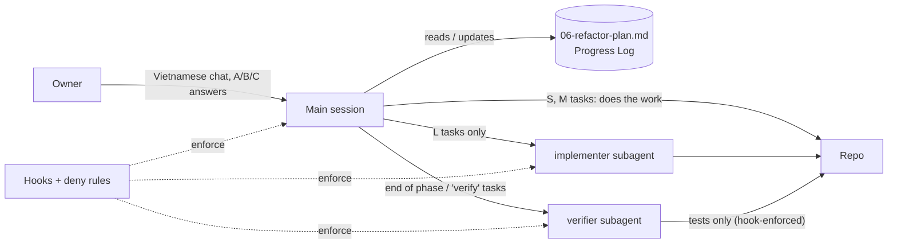

# 08 — Agent System

> Decision record: `05-decisions/ADR-009-agent-system.md`. Built by task **T-P0-02**, which creates
> every file in §4–§8 **verbatim** from the fenced blocks below and deletes the files listed in §9.
> The three hook scripts in §6 were run against sample inputs on 2026-11-13 (results in §6.4).

## 1. Operating model



| Element | Purpose | Loaded |
|---------|---------|--------|
| `CLAUDE.md` | Commands, non-negotiables, pointers | Every session |
| `.claude/rules/core.md` | Privacy, owner communication, decision log, git | Every session |
| `.claude/rules/{engine,ui,api-db,testing,docs}.md` | Rules for one area | When a matching file is read or edited |
| `.claude/skills/*` | Procedures | When invoked or relevant |
| `.claude/agents/*` | Isolated workers | When the main session delegates |
| `.claude/settings.json` + `.claude/hooks/*` | Rules with zero exceptions | Always (enforced by the harness) |
| `docs/redesign/06-refactor-plan.md` | Task list + Progress Log = the only project state | Start of each execution session |

## 2. Session protocol

1. `git fetch origin main`; read `CLAUDE.md` (automatic) and the Progress Log.
2. Take the first task whose status is `todo` and whose dependencies are `done`. One task per session.
3. Follow the `execute-task` skill. Stop and ask the owner (A/B/C, recommended option marked) when the task needs a decision that the documents do not make, or when a "stop" condition in `CLAUDE.md` is met.
4. Finish = verification commands pass, Progress Log updated, commit pushed. Report in Vietnamese: what was done, evidence (command + result), what was not done, open questions.

## 3. Delegation rules

| Situation | Who |
|-----------|-----|
| Task size S or M | Main session |
| Task size L | `implementer` (one at a time), with the task ID and a context pack: files, ADRs / sections to read, risks |
| End of each phase; tasks marked **verify** | `verifier`, with: commit range, task IDs, acceptance criteria, risk points |
| Broad code search | Built-in Explore agent |

Never run two subagents at once. A subagent stopped by the usage limit is resumed with a message to
the same agent, not replaced. Record tokens per subagent run in the Progress Log notes.

## 4. `CLAUDE.md`

Already replaced in the commit that introduced this document. Its "Transition" section is removed
step by step by T-P0-01, T-P0-02 and T-P1-05.

## 5. Rules (`.claude/rules/`)

### 5.1 `core.md` (no frontmatter → always loaded)

````markdown
# Core rules

## Data and privacy (never broken)

- File content and HR data never leave the browser: no upload, no logging (including `console`), no telemetry, no `localStorage` / IndexedDB / URL. Files are read and processed only in the Web Worker.
- The server stores only: accounts, flow configuration, reference tables without personal data, run metadata (file names as SHA-256, error keys, no raw text).
- Every Supabase table has RLS. The client never uses a service-role key.
- User-entered parameters are bound as values, never concatenated into SQL.
- CSP `connect-src` is the app origin, the Supabase project and `blob:`. No new external origin, no new dependency, without the owner's approval. Dependencies: MIT / Apache / BSD preferred.
- The owner tests with real files on his own machine. That content never goes into chat, screenshots, fixtures or commits. If data looks real, say so and do not copy it.

## Working with the owner

- Talk to the owner in Vietnamese (keep English technical terms). Conclusion first, then reasons. Minimal formatting.
- Questions: numbered, each with 2–3 options A/B/C, one marked recommended, one-line trade-off. The owner answers like "1A, 2B".
- Risky matters (data, security, cost): give the facts and options; the owner decides.
- Report truthfully: failed checks are reported as failed; skipped steps are named.

## Decisions

- When the owner settles something, add one line at the top of the right group in `docs/MEMORY.md`: `YYYY-MM-DD HH:MM - <decision>` (Vietnamese; time from `TZ=Asia/Ho_Chi_Minh date '+%Y-%m-%d %H:%M'`), and update the affected file in `docs/redesign/` in the same commit.
- A changed decision is never deleted: move the old line to `docs/MEMORY-archive.md` as `~~…~~ → thay bởi <time>`.
- Before proposing a change in an area, grep `docs/MEMORY.md` for that topic. A request that contradicts it → stop and ask.

## Git

- Never write the owner's company name anywhere. Use "the company".
- No secrets in commits; only `.env.example` files are committed.
- Commit messages in English, one purpose per commit. Do not commit code that fails lint, typecheck or tests.
- `main` is production (Cloudflare Pages deploys from it). Work on a branch; merge with the `release` skill.
````

### 5.2 `engine.md`

````markdown
---
paths:
  - "apps/web/src/engine/**"
  - "packages/flow-schema/**"
---

# Engine and flow schema

- The engine is pure TypeScript: no React, no DOM, no `console`. It imports only `engine/**` and `@hrflow/flow-schema`. It must run under Node for tests.
- Code outside `engine/` imports only `engine/protocol` and `engine/formula/public`. To expose something new, re-export it from one of those two files.
- One node type = one plugin file in `engine/nodes/`, registered in `engine/nodes/index.ts`; config schema in `packages/flow-schema`. Adding a node: use the `add-node` skill. The core executor is not edited for a new node.
- Money and day counts use decimal (`big.js`, `DECIMAL(38,10)`), never float. Decimals cross to the UI as strings.
- Errors and validation messages are i18n keys with params (`locales/vi/engine.json`); they name the node, file, source row and column; they never contain cell content beyond what the validation report shows on screen.
- No business format is hard-coded (e.g. employee-code shape): it is flow configuration.
- Never `arr.push(...big)` or spread a large array into a call (stack overflow above ~100k rows).
- Semantics that exist in both TypeScript and SQL (key normalisation, decimal, blank cells): change both sides and their equivalence test together.
- Code that parses external files (unzip, xlsx, formula parser): ask the `verifier` to fuzz it in the same round.
- Behaviour reference: `docs/archive/spec.md` §8–§14, §24, §27. Summary of rules: `docs/redesign/03-domain-and-data-model.md` §4.
````

### 5.3 `ui.md`

````markdown
---
paths:
  - "apps/web/src/**/*.tsx"
  - "apps/web/src/**/*.css"
  - "apps/web/index.html"
  - "apps/web/public/**"
---

# UI

- Design source: `docs/redesign/04-ui-ux-system.md`. Files listed in `apps/web/src/ui/__tests__/v3-scope.ts` follow DS v3; other files stay on v2 until their migration task. Never add new v2 usage to a migrated file, never add a new file outside the v3 rules.
- Visual values exist only in `src/ui/tokens/*.css`. Feature code uses semantic utilities (`text-fg-muted`, `gap-group`, `h-ctl`) and `ui` components. No hex, no arbitrary value, no Tailwind default palette, no `className` passed to `ui` components.
- A screen picks one page template (04 §7.1). It never writes its own `<main>`, page frame, `<table>`, form field, dialog, toast, popover, file input, or SVG icon. Missing pattern → add it to `src/ui/` and to 04 first.
- Density comes from `data-density` on the layout container. Components never take a `dense` flag.
- Every data view shows loading, empty, error and success states.
- Every visible string is an i18n key (`locales/vi`). No Vietnamese literal in `.tsx`. Labels and errors never show internal keys or config paths. One term per concept.
- No native `<select>`, date / month input, or visible `<input type="file">`.
- Accessibility: real `<button>` / `<a href>` / `<label>`; visible focus; APG patterns; contrast per 04 §5.2.
- Heavy libraries stay in lazy chunks; `ui/data/DataGrid` is imported by path, not through the `ui` barrel. State the remaining start-up JS budget at the start of a UI task.
- Do not rely on Tailwind class order to override another class.
- New screen or changed layout: build an Artifact mock-up, get the owner's approval, then code (skill `ui-screen`). Inspect every screenshot at 1280, 1024 and 390 px yourself before showing the owner.
````

### 5.4 `api-db.md`

````markdown
---
paths:
  - "apps/web/src/api/**"
  - "supabase/**"
---

# Data access and database

- `src/api/**` is the only code that imports the Supabase client. One module per resource; plain async functions taking the client first; every failure is thrown as `ApiError { key }` (mapping in `api/errors.ts`). No raw server message reaches the UI.
- `database.types.ts` is hand-written: change it in the same commit as the migration and diff it against generated types (skill `db-migration`).
- A released migration file is never edited (hook-enforced). New change = new file.
- New table: `revoke all … from public, anon, authenticated` first, then explicit grants, RLS enabled, policies, and a test in `supabase/tests/` wrapped in `begin … rollback`.
- Through the Supabase MCP connection, SQL containing `drop` or `delete` hangs and is cancelled: keep those words out of migrations where possible; otherwise give the owner the SQL for the dashboard SQL editor.
- RLS / RPC changes run the real-database tests (workflow "Database tests on Supabase") and the security advisor before reaching `main`.
- The repo may be public: no dump, secret or unencrypted data in artifacts, logs or commits.
- Model and access matrix: `docs/redesign/03-domain-and-data-model.md`.
````

### 5.5 `testing.md`

````markdown
---
paths:
  - "**/__tests__/**"
  - "**/*.test.ts"
  - "**/*.test.tsx"
  - "e2e/**"
  - "fixtures/**"
---

# Testing

- Fake data only (`fixtures/`, generated with a fixed seed). Never real data.
- The acceptance flow must match `fixtures/payroll-timesheet/expected.json`; the 182 formula golden cases must pass. These are not edited to make a change pass.
- Never skip or disable a test to get green. Known bug: `it.fails` / `test.fail` in a "KNOWN BUG" group.
- Behavioural E2E assertions (text, roles, network, storage, downloads) are never weakened. Visual-value assertions and screenshot baselines change only in the task that migrates that screen, and each regenerated image is inspected.
- Flaky test or screenshot: do not raise a threshold; on the second occurrence find the cause.
- Heavy tests are opt-in: `HRFLOW_PERF=1`, `HEAVY_E2E=1`.
- E2E runs only after `pnpm --filter @hrflow/web build:e2e` exits 0, with the pre-installed Chromium (no `playwright install`), with `--trace off`. A stopped run can leave `vite preview` on port 4173: find it (`ps -eo pid,args | grep "vite.js preview"`) and stop it first.
- Changing a default text breaks text-bound E2E tests and baselines: run the full E2E, not only unit tests.
- Test output goes to the OS temp directory, never into the repo.
- Counts and measurements written into documents come from a command just run.
````

### 5.6 `docs.md`

````markdown
---
paths:
  - "docs/**"
  - "CLAUDE.md"
  - "README.md"
  - ".claude/**"
---

# Documents

- Precedence: `docs/MEMORY.md` > `docs/redesign/` > code > `docs/archive/`.
- `docs/redesign/` is English, tables over prose, every claim about the code backed by a path; unverified claims are labelled UNVERIFIED; each file ends with decisions / assumptions / open questions.
- `docs/MEMORY.md` is Vietnamese, one line per decision, newest first in its group; only what the owner confirmed.
- `docs/archive/` is frozen (hook-enforced).
- Project status lives only in the Progress Log of `docs/redesign/06-refactor-plan.md`.
- Code change that makes a document wrong → fix the document in the same commit.
- Do not create planning or analysis files unless the owner asks.
- `CLAUDE.md` stays under 120 lines; anything area-specific goes to a path-scoped rule, any procedure to a skill.
````

## 6. Settings and hooks

### 6.1 `.claude/settings.json`

````json
{
  "permissions": {
    "deny": [
      "Read(./.env)",
      "Read(./.env.local)",
      "Read(./apps/web/.env.local)",
      "Read(./**/.env.*.local)"
    ]
  },
  "hooks": {
    "PreToolUse": [
      {
        "matcher": "Edit|Write",
        "hooks": [
          {
            "type": "command",
            "command": "\"$CLAUDE_PROJECT_DIR\"/.claude/hooks/protect-files.sh"
          }
        ]
      }
    ],
    "PostToolUse": [
      {
        "matcher": "Edit|Write",
        "hooks": [
          {
            "type": "command",
            "command": "\"$CLAUDE_PROJECT_DIR\"/.claude/hooks/format.sh"
          }
        ]
      }
    ]
  }
}
````

### 6.2 `.claude/hooks/protect-files.sh` (mode 755)

````bash
#!/bin/bash
# PreToolUse (Edit|Write): blocks edits to files an agent must never change.
# Exit 2 blocks the tool call; stderr is shown to Claude as the reason.
command -v jq >/dev/null || { echo "protect-files: jq is required" >&2; exit 2; }
FILE=$(jq -r '.tool_input.file_path // empty')
[ -z "$FILE" ] && exit 0
ROOT="${CLAUDE_PROJECT_DIR:-$(pwd)}"
REL="${FILE#"$ROOT"/}"
deny() { echo "Blocked: $REL - $1" >&2; exit 2; }
case "$REL" in
  vendor/*) deny "vendored files are immutable (checksums in vendor/README.md)" ;;
  docs/archive/*) deny "archived documents are frozen; write to docs/redesign/ or docs/MEMORY.md" ;;
  *.env.example) ;;
  .env | .env.* | */.env | */.env.*) deny "env files may hold secrets; edit .env.example only" ;;
  supabase/migrations/*)
    REF=HEAD
    git -C "$ROOT" rev-parse -q --verify origin/main >/dev/null 2>&1 && REF=origin/main
    if git -C "$ROOT" cat-file -e "$REF:$REL" 2>/dev/null; then
      deny "a released migration is never edited; add a new file (skill: db-migration)"
    fi
    ;;
esac
exit 0
````

### 6.3 `.claude/hooks/verifier-test-only.sh` and `.claude/hooks/format.sh` (mode 755)

````bash
#!/bin/bash
# PreToolUse (Edit|Write) for the verifier subagent: it may write tests, fixtures and E2E only.
command -v jq >/dev/null || { echo "verifier-test-only: jq is required" >&2; exit 2; }
FILE=$(jq -r '.tool_input.file_path // empty')
[ -z "$FILE" ] && exit 0
ROOT="${CLAUDE_PROJECT_DIR:-$(pwd)}"
REL="${FILE#"$ROOT"/}"
case "$REL" in
  e2e/* | fixtures/* | supabase/tests/* | */__tests__/* | *.test.ts | *.test.tsx | *.spec.ts) exit 0 ;;
esac
echo "Blocked: the verifier writes only test, fixture and E2E files ($REL). Report the finding instead." >&2
exit 2
````

````bash
#!/bin/bash
# PostToolUse (Edit|Write): format the edited file with the repo's Prettier. Never blocks.
command -v jq >/dev/null || exit 0
FILE=$(jq -r '.tool_input.file_path // empty')
ROOT="${CLAUDE_PROJECT_DIR:-$(pwd)}"
case "$FILE" in
  *.ts | *.tsx | *.js | *.mjs | *.json | *.css | *.yml | *.yaml | *.html)
    [ -x "$ROOT/node_modules/.bin/prettier" ] &&
      (cd "$ROOT" && node_modules/.bin/prettier --write --log-level=error "$FILE" >/dev/null 2>&1)
    ;;
esac
exit 0
````

### 6.4 Test record (2026-11-13, sample stdin `{"tool_input":{"file_path":"…"}}`)

| Script | Path | Exit |
|--------|------|------|
| protect-files | `vendor/README.md`, `docs/archive/spec.md`, `apps/web/.env.local`, `.env`, `supabase/migrations/20261026080000_core_schema.sql` | 2 (blocked) |
| protect-files | `apps/web/.env.example`, `supabase/migrations/20261201000000_new.sql` (new file), `apps/web/src/app/App.tsx`, `apps/web/src/api/env.ts` | 0 |
| verifier-test-only | `apps/web/src/app/App.tsx` | 2 |
| verifier-test-only | `apps/web/src/ui/__tests__/x.ts`, `e2e/user/run.spec.ts`, `apps/web/src/lib/format.test.ts` | 0 |
| format | a badly formatted `.js` file | 0, file reformatted |

Known limits: hooks match the `Edit` and `Write` tools only; a shell command can still write a
file, so the rules in §5 remain stated in prose as well. `*.md` and `.claude/**` are ignored by
Prettier (`.prettierignore`).

## 7. Subagents (`.claude/agents/`)

### 7.1 `implementer.md`

````markdown
---
name: implementer
description: Implements one large (size L) task from docs/redesign/06-refactor-plan.md, exactly as written. Use only when the main session delegates a task ID.
tools: Read, Grep, Glob, Edit, Write, Bash
model: opus
---

You implement exactly one task of `docs/redesign/06-refactor-plan.md`. You are given its ID and a
context pack.

Before coding
1. Read `CLAUDE.md`, the task, and only the sections the task or the context pack names.
2. Read the code you will change and write in the style around it.
3. If the task is unclear, contradicts `docs/MEMORY.md` or `docs/redesign/`, or needs a design decision: stop and return the questions (2–3 options each, one recommended). Do not guess.

Rules that always apply
- File content and HR data never leave the browser, are never logged, never stored.
- No new dependency, no CSP change, no schema change unless the task says so.
- Follow the dependency rules in `docs/redesign/02-target-architecture.md` §3 and the conventions in `07-conventions.md`.
- Smallest change that satisfies the task. No extra refactoring, no behaviour change outside the task.
- Never edit a test to make it pass unless the task lists that test.

Before reporting done
- Run the task's verification commands. All must pass. Commit and push each passing part (English, Conventional Commits, task ID in the subject).

Return (short)
- Files changed, one line each.
- Each acceptance criterion: met / not met.
- Commands run and their real results, including failures.
- Risks and cases the verifier should check.
````

### 7.2 `verifier.md`

````markdown
---
name: verifier
description: Independent verification after a phase or a task marked "verify" - checks the diff against the task's acceptance criteria, runs the full checks, probes data-leak and security risks. Writes tests only. Use after implementation, before merging to main.
tools: Read, Grep, Glob, Edit, Write, Bash
model: opus
hooks:
  PreToolUse:
    - matcher: "Edit|Write"
      hooks:
        - type: command
          command: "\"$CLAUDE_PROJECT_DIR\"/.claude/hooks/verifier-test-only.sh"
---

You verify work you did not write. You are given a commit range, task IDs, their acceptance
criteria and risk points. Test against the requirements, not against the implementation.

Priority
1. Data leak: can file content or HR data reach the server, console, logs, browser storage, the URL or the run log? Check network and storage in E2E.
2. Security: RLS, no service key in the client, parameters bound not concatenated, CSP not widened, `code.sql` guard not bypassable.
3. Correctness against each acceptance criterion; behaviour lock (acceptance flow output and formula golden cases unchanged).
4. Dependency rules (`docs/redesign/02-target-architecture.md` §3) and decisions in `docs/MEMORY.md` for the touched area.

Rules
- Fake data only. You may write test, fixture and E2E files; nothing else (enforced by a hook). Do not change application code through the shell either.
- Known bug: add an `it.fails` / `test.fail` test in a "KNOWN BUG" group. Never skip a test.
- Run: `pnpm lint`, `pnpm format:check`, `pnpm typecheck`, `pnpm test`, `pnpm build`, and for UI or worker changes `pnpm --filter @hrflow/web build:e2e` then the E2E specs of the touched area with `--trace off`.
- Report only findings that affect correctness, security or data safety, each reproduced by you. Skip style.

Return (short)
```
[BLOCKING|MAJOR|MINOR] file:line - description
  Scenario: <input / state -> consequence>
  Suggested fix: <short>
```
Then: real results of the checks, criteria not verified and why, verdict `PASS` (no BLOCKING / MAJOR) or `CHANGES REQUIRED`.
````

## 8. Skills (`.claude/skills/<name>/SKILL.md`)

### 8.1 `execute-task`

````markdown
---
name: execute-task
description: Run one task (T-Pn-nn) of docs/redesign/06-refactor-plan.md from start to finish. Use at the start of every refactor session or when the owner says "continue the plan".
---

1. `git fetch origin main`. Open `docs/redesign/06-refactor-plan.md`, read the Progress Log. Pick the first `todo` task whose dependencies are all `done` (or the ID the owner gave). Set it to `in progress` with today's date.
2. Read the whole task and the sections it cites. Do not read other documents.
3. If the task is size L, delegate it to the `implementer` subagent with the task ID and a context pack (files, sections, risks). Otherwise do it yourself.
4. Follow the steps literally. A step that cannot be done as written, or a needed decision the documents do not make: stop, ask the owner (A/B/C, one recommended). Never redesign silently.
5. Run every verification command of the task. Quote each command and its result in the report. A failing check is fixed or reported, never hidden.
6. If the task is marked **verify**, or it is the last task of a phase, run the `verifier` subagent on the commit range; fix BLOCKING / MAJOR findings and re-verify once. A second failure: stop and report.
7. Update the Progress Log row (status `done`, date, one-line note with numbers measured now: tests passed, start-up JS, tokens used by subagents). Update any redesign document the change made wrong.
8. Commit (English, Conventional Commits, task ID in the subject: `refactor(api): T-P1-01 …`) and push to the working branch.
9. Report to the owner in Vietnamese: done / evidence / not done / questions.
````

### 8.2 `clarify`

````markdown
---
name: clarify
description: Clarify and settle a new or vague requirement with the owner before any code - fact-check first, ask A/B/C questions, write acceptance criteria, record the decision. Use for any request that is not already a task in the plan.
---

1. Analyse. Grep `docs/MEMORY.md` for the topic; read only the relevant sections of `docs/redesign/` (and `docs/archive/spec.md` when behaviour detail is needed). Identify the goal, the role (Admin / User), the data involved, the risks (personal data, performance, free tier, usage limit). Verify what can be verified in code or vendor docs first; label statements [Certain] / [High confidence] / [Speculative].
2. Conflict with `docs/MEMORY.md` or `docs/redesign/` → state it at once and ask.
3. Questions (Vietnamese): only those that change the design, at most 5 per round, ordered by impact:
   `N. <question>?` then `A (đề xuất): … / B: … / C: …`, each with a one-line trade-off. The owner answers "1A, 2B".
4. Record: one line per settled decision in `docs/MEMORY.md` (rules in `.claude/rules/core.md`); update the affected `docs/redesign/` file in the same commit; unsettled items go to that file's open-questions table.
5. Write the work as tasks in the format of `docs/redesign/06-refactor-plan.md` §2 (goal, files, steps, acceptance criteria that can be tested, verification commands, rollback, size ≤ L) and append them to the plan's backlog section with status `todo`.
6. UI work: build an Artifact mock-up and get approval before the tasks are written (skill `ui-screen`).
````

### 8.3 `add-node`

````markdown
---
name: add-node
description: Add a new node type to the flow engine and the Designer. Use when a task or the owner asks for a new node (for example input.refTable, output.template).
---

A node type lives in five places; `features/designer/__tests__/node-coverage.test.ts` fails until all exist.

1. Schema: add `<Name>ConfigSchema` (+ type) to `packages/flow-schema/src/nodes.ts` or `transforms.ts`; export it; add schema tests.
2. Engine: create `apps/web/src/engine/nodes/<group>-<name>.ts` exporting a `NodePlugin` (`type`, `configSchema`, `inputs`, `outputs`, `inferSchema`, and `execute` or `runSql`); register it in `engine/nodes/index.ts`. Errors are `EngineError` with an i18n key in `locales/vi/engine.json`. Unit tests in `engine/__tests__/`.
3. Catalog: add an entry to `NODE_TYPES` in `apps/web/src/features/designer/catalog.ts` (group, idPrefix, ports mirroring the plugin, `defaults`).
4. Form: create `apps/web/src/features/designer/nodes/<group>-<name>.tsx` (uses `forms/fields.tsx` and `ui` only) and register it in `nodes/registry.ts`.
5. Texts: `locales/vi/designer.json` → `node.<type>.name`, `.description`, field labels, issue texts.
6. Run `pnpm test`; add the node to `e2e/layout-lint` node-form coverage and, if it changes results, a fixture with expected output under `fixtures/`.
7. Behaviour that the owner must decide (blank handling, key matching, limits) → `clarify` first.
````

### 8.4 `ui-screen`

````markdown
---
name: ui-screen
description: Build a new screen or migrate an existing screen to Design System v3. Use for any task that creates or restyles a page, dialog or panel.
---

1. Read `docs/redesign/04-ui-ux-system.md` §4 (page row), §6 (components), §7 (template), §11 (v2 → v3 mapping). State the remaining start-up JS budget (`pnpm build` output).
2. New screen or changed layout: build an Artifact mock-up with fake data, check 1280 / 1024 (and 390 for User screens) for overflow and overlap, get the owner's approval. A pure migration of an existing screen skips this step.
3. Compose from one page template and `ui` components only. Missing component or variant → add it to `src/ui/` and to 04 §6 in the same commit, never inline.
4. Implement the four states: loading, empty, error, success. All strings through i18n.
5. Migration: replace v2 utilities by the 04 §11 mapping; delete imports from `src/components/`; add the folder or file to `src/ui/__tests__/v3-scope.ts`.
6. Tests: update only visual-value assertions and baselines of this screen (`CI=1 npx playwright test <spec> --update-snapshots --trace off` after `pnpm --filter @hrflow/web build:e2e`); inspect every regenerated image yourself at each viewport; add the screen to `e2e/layout-lint` if new.
7. Run: `pnpm lint && pnpm typecheck && pnpm test && pnpm build`, then the E2E specs of the area plus `e2e/**/privacy.spec.ts`, `layout-lint`, `a11y`.
8. Show the owner one before / after set, once.
````

### 8.5 `db-migration`

````markdown
---
name: db-migration
description: Create, test and apply a Supabase schema, RLS or RPC change. Use for any change under supabase/migrations.
---

1. Write a new file `supabase/migrations/<UTC yyyymmddhhmmss>_<name>.sql`. Additive first; no edit of an existing file. New table: `revoke all … from public, anon, authenticated`, explicit grants, `enable row level security`, policies. Functions: `set search_path = ''`, `security invoker` unless a comment explains why definer is needed.
2. Write or extend a test in `supabase/tests/` wrapped in `begin; … rollback;` that proves each policy for admin, active user, inactive user and anon.
3. Update `apps/web/src/api/database.types.ts` in the same commit.
4. Local: run `scripts/db-tests.sh` against a local Postgres.
5. Before a migration that rewrites existing rows: run the "Supabase backup" workflow and wait for green (it includes a restore check).
6. Apply to the real database with the Supabase MCP `apply_migration` (records history). SQL containing `drop` or `delete` cannot go through MCP: give the owner the exact SQL for the dashboard SQL editor, including the history row.
7. Run the workflow "Database tests on Supabase"; read the log; every file must print its OK line.
8. Run the security advisor; new findings are fixed or explained in the Progress Log.
9. Generate types from the real database and diff against `database.types.ts`; fix differences.
10. Rollback note in the task: the forward-fix migration that undoes the change.
````

### 8.6 `release`

````markdown
---
name: release
description: Merge the working branch into main (production deploy). Only when the owner asks.
disable-model-invocation: true
---

1. Working tree clean; branch up to date with `origin/main` (rebase if needed).
2. Run and require green: `pnpm lint`, `pnpm format:check`, `pnpm typecheck`, `pnpm test`, `pnpm build`, `pnpm test:e2e` (full, on the fresh `build:e2e`).
3. Database changes in the range: the `db-migration` skill steps 6–9 are done and logged.
4. `verifier` verdict for the range is `PASS`.
5. Fast-forward `main` to the branch and push. Cloudflare Pages deploys from `main`.
6. Open the production URL, sign in, run the acceptance flow once with the fixture files, confirm the result downloads.
7. Record the release (date, commit, checks) in the Progress Log.
````

## 9. Files removed by T-P0-02

| Remove | Replaced by |
|--------|-------------|
| `.claude/rules/communication.md`, `decision-log.md`, `data-privacy.md`, `git.md`, `workflow.md`, `pitfalls.md` | `core.md` + path-scoped rules + skills + this document |
| `.claude/rules/design.md` | `ui.md` |
| `.claude/rules/engine.md`, `testing.md` | same names, new content |
| `.claude/agents/developer.md` | `implementer.md` |
| `.claude/agents/verifier.md` | same name, new content |
| `.claude/skills/clarify/SKILL.md` | same name, new content |

Every lesson in the old `pitfalls.md` is carried into a rule or skill above (process → §2–§3 and
`execute-task`; UI → `ui.md`, `ui-screen`, `testing.md`; Supabase → `api-db.md`, `db-migration`;
engine → `engine.md`).

## 10. Decisions, assumptions, open questions

| ID | Type | Statement |
|----|------|-----------|
| D-08-1 | DECISION | Two subagents, six skills, six rule files, three hooks, as specified. |
| A-08-2 | ASSUMPTION | Subagent frontmatter accepts the `hooks:` block in the form shown in §7.2 (field listed in the Claude Code subagent docs; exact YAML shape **UNVERIFIED**). T-P0-02 checks with `/hooks` or a blocked test edit; if unsupported, the prose rule remains and this is logged. |
| A-08-3 | ASSUMPTION | The executor runs in an environment with `jq`, `bash` and `git` (true for the cloud environment used so far). |
| Q-08-1 | OPEN QUESTION | Should a `Stop` hook run `pnpm typecheck` automatically? Default: no (≈ 1 minute per turn); the `execute-task` skill and CI cover it. |
